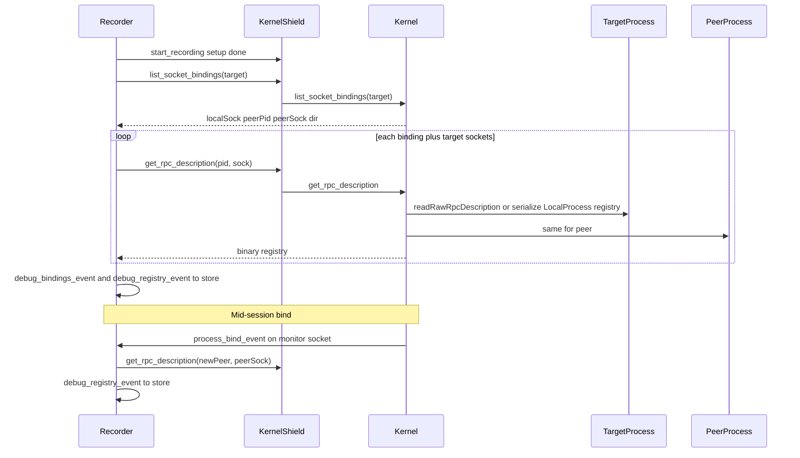

# Recording debugger

Product and contract spec for debugging WASM processes from **recorder / debug-store dumps**, without a live kernel.

Related:

- Kernel recording model: [`ts-kernel/README.md`](../ts-kernel/README.md) — *Process recording and replay*
- Recorder design: [`recorder/DESIGN.md`](../recorder/DESIGN.md)
- Debug-store layout: [`debug-store/README.md`](../debug-store/README.md)
- Implementation checklist: [`TODO.md`](./TODO.md)

Status: **§1–§9 implemented** — packer (`.waosrec`), headless `ReplayRuntime` under [`src/replay/`](./src/replay/), Recording UI (timeline / scrubber / hex+RPC decode / `globalThis.replay`). Interactive remains available behind a mode switch.

---

## 1. Goal and non-goals

### Goal

Verify that a recording is correct by running a **deterministic replay of the target WASM module without the kernel**, and inspect the same dump in a web UI:

- Timeline of monitor events (stimulus / expect / topology)
- RPC decode using captured `type_registry` blobs (target + bound peers)
- Step / seek under browser DevTools (`globalThis.replay`)

Primary workflow: open a dump → scrub timeline → assert OUT bytes → decode socket traffic.

### Non-goals (this product track)

- Full live kernel in the browser
- DWARF / source-level debug (v1)
- Recorder `dump_and_rotate` and seal-on-stop polish (separate recorder work)
- Expanding the existing **Interactive** “call method on loaded module” UI (legacy; keep code, do not grow it here)

---

## 2. Modes in module-debugger

| Mode | Status | Role |
|------|--------|------|
| **Recording** | Default UI | Open `.waosrec` / session folder; timeline, scrubber, hex + registry decode; `globalThis.replay` |
| **Interactive** | Legacy | Load a WASM module, inspect registry, call methods via local RPC host — no kernel, no dump. Remains in the codebase for ad-hoc module poking; future “Interactive + Kernel” is out of scope for now |

Default product focus is **Recording**.

---

## 3. Replay semantics

Aligned with [`ts-kernel/README.md`](../ts-kernel/README.md) *Debug replay model*, plus topology metadata.

Replay runs an **isolated** WASM instance: no kernel, no peer processes, no real binds. Recorded socket I/O replaces the external world.

| Class | Examples | On replay |
|-------|----------|-----------|
| **Stimulus (environment)** | `Copy IN` (+ payload), `Data IN`, `Drain OUT`, `MANA` | **Apply** — inject bytes / call exports (`waos_socket_data`, `waos_socket_output_drain`, host mana APIs) |
| **Expect (module)** | `Copy OUT` (+ payload) | **Assert** — compare bytes the module flushed via `waos_socket_flush` with the recording; mismatch = hard replay error |
| **Topology (metadata)** | `process_bind_event`, `process_unbind_event` | **Do not** call `kernel.bind` / module bind — update debugger topology map and which registries apply for decode |
| **Anchor / end** | `process_save_event` (packer/session), `ERROR` / dump marker | Snapshot restore / stop session |

### Ordering

Same FIFO as the kernel pump:

1. Replay events (`Copy`, then `Data` / `Drain`) are emitted **before** the process side effect.
2. Monitoring-only buffer-state events are not part of the recording window (recorder does not subscribe to `INITIAL_*` / `BUFFER_*`).
3. `BIND` is emitted **after** `socketConnections` update and **before** the first `Copy` that uses the new link.

Seek backward = restore memory from the session snapshot + replay events from the anchor up to index N; rebuild topology from BIND/UNBIND in that prefix.

### Mana and WASI

- In-module `waos_use_mana` is deterministic; no event required.
- Host `measure_mana` / `set_mana_limit` → `MANA` events when recorded.
- Snapshot carries `mana_used` / `mana_limit` at save time.
- WASI (e.g. `printf`) ignored for determinism in v1.

### Why topology events are required

Inferring bind/unbind only from I/O on the target’s kernel-API socket is **incomplete**:

- Host / orchestrator often calls `kernel.bind` without any RPC frame on the monitored process.
- Mid-session binds change which peer registry is needed for decode.
- A snapshot of bindings at `start_recording` alone misses later graph changes.

The claim in older kernel docs that bind/unbind need no separate monitor types is **outdated**; recording must use dedicated BIND events (see §6). Kernel README should be updated when those events are implemented.

---

## 4. Recording artifact: `.waosrec`

Single-file dump for the debugger (packer input = one debug-store session directory).

### Suggested layout

Length-prefixed sections (or equivalent TLV/CBOR). Logical contents:

| Section | Content |
|---------|---------|
| `manifest` | Session meta + chosen snapshot meta (`format_version`, `session_meta`, `snapshot_meta`) — typed binary |
| `code` | Target WASM bytes from host `start_recording.code` (`code.wasm`; may be empty) |
| `memory` | Linear memory at the dump anchor (`snap.<uid>.bin`) |
| `events` | Opaque concatenation of length-prefixed monitor wire frames (same as `io.bin`) |
| `bindings` | Typed `bindings_snapshot` (`bindings.bin`) |
| `registries` | One binary `rpc_description` per `(process_id, socket_id)` |

### Mapping from debug-store session

Today ([`debug-store/README.md`](../debug-store/README.md)):

```text
sessions/<id>/meta.bin
sessions/<id>/snap.<uid>.bin
sessions/<id>/snap.<uid>.meta.bin
sessions/<id>/io.bin
sessions/<id>/bindings.bin
sessions/<id>/registry.<pid>.<sock>.bin
sessions/<id>/code.wasm
```

Packer (`waosrec pack`, owner = recorder) merges these into a single typed `.waosrec` blob (highest `snapshot_uid`). The host passes target WASM in `start_recording.code` — there is no kernel/shield `get_code`.

### `bindings.bin`

Serialized `bindings_snapshot`:

- `process_id` — recorded target
- `bindings[]` — `{ socket, peer_process, peer_socket, direction }` with `kernel.direction` enum (`NONE`/`IN`/`OUT`/`BOTH`)

### Registry blobs

- File name: `registry.<process_id>.<socket_id>.bin`
- Payload: raw `rpc_description` bytes (same wire as WASM `rpc_description` export / serialized `TypeRegistry`)
- Empty file or missing file → `registry_status: missing` for that key; do not fail the whole session
- Written at start for target sockets + peers; **updated/added** when a `process_bind_event` introduces a new peer (see §7)

---

## 5. ReplayRuntime (no kernel)

Implemented in [`src/replay/`](./src/replay/):

| File | Role |
|------|------|
| `load.ts` | `loadSessionDir` (binary session files) + `loadWaosrec` (typed `.waosrec` via fixture registry) |
| `frames.ts` | `parseMonitorFrames` / classify stimulus · expect · topology |
| `host.ts` | Kernel-free WASM host; restore snapshot memory; capture flush OUT |
| `runtime.ts` | `ReplayRuntime.create` / `step` / `run` with OUT asserts + topology map |

Algorithm:

1. Instantiate target WASM with minimal imports.
2. Restore linear memory from the dump snapshot (after optional `_initialize`/`start`, memory is overwritten from the snap).
3. Walk `events` in order; for each decoded monitor frame apply §3.

### Required imports

| Import | Behavior |
|--------|----------|
| `waos_socket_flush` | Capture OUT bytes for expect vs recorded `Copy OUT` |
| `waos_socket_input_drain` | As needed when applying IN path |
| `waos_use_mana` | Passthrough / accounting consistent with snapshot |
| Host hooks for `Data` / `Drain` | Call `waos_socket_data` / `waos_socket_output_drain` |

No peer sockets: IN payloads come from recorded `Copy IN`; OUT is only asserted.

BIND/UNBIND update an in-memory `Map<localSocket, { peerProcess, peerSocket, direction }>` used by the decoder UI, not by WASM.

Control surface: `state` + `step` / `run` / `seek`; DevTools via `installReplayDevtools` → `globalThis.replay`.

---

## 6. Recording pipeline — kernel / shield / recorder / store

Registries and topology must be collected by **recorder.wasm** via kernel APIs (through kernel-shield), not only by a TypeScript harness. Production dumps without a custom host would otherwise be undecodable.



### 6.1 Monitor flag and events: BIND

Next free bit after `MANA = 1 << 12`:

```text
monitor_flag.BIND = 1u << 13
```

Include `BIND` in the recorder’s recording monitor preset (in addition to today’s `COPY | COPY_PAYLOAD | DATA | DRAIN | SAVE | ERROR` and optional `MANA`).

New message types (bases: `process_event`):

```text
process_bind_event {
  process          // monitored process (from process_event)
  socket           // local socket on monitored process
  peer_process
  peer_socket
  direction        // same as kernel.bind
}

process_unbind_event {
  process
  socket
  peer_process
  peer_socket
  direction
}
```

Contract sources to update when implementing: [`cpp-rpc/src/examples/structures/kernel.hpp`](../cpp-rpc/src/examples/structures/kernel.hpp), [`ts-kernel/src/kernelApi.ts`](../ts-kernel/src/kernelApi.ts), [`ts-kernel/src/ProcessMonitorEmitter.ts`](../ts-kernel/src/ProcessMonitorEmitter.ts).

**Emit rules:**

- After successful `kernel.bind` / `kernel.unbind`, emit to monitors of **both** processes (from and to) that subscribed with `BIND`.
- For each monitored process, `socket` / peers are expressed relative to **that** process.
- Emit immediately after updating `socketConnections`, before any pump `Copy` on the new edge.
- Does not replace Copy/Data/Drain; topology only.
- Wire frames are length-prefixed like other monitor events; recorder appends them **opaque** into `io_bytes` (same as Copy/Data/Drain).

**Replay:** topology class — no WASM side effect.

### 6.2 Kernel RPC: bindings and registries

Append to `kernel` (method ids at end of list; regenerate stubs):

```text
list_socket_bindings(process_id)
  → vector<{ socket, peer_process, peer_socket, direction }>
  // from Process.socketConnections (connectedTo / connectedFrom)

get_rpc_description(process_id, socket_id) → binary
  // ModuleProcess: readRawRpcDescription(socket) — do not rely on single-socket getRpcDescription cache
  // LocalProcess: serialize TypeRegistry from getRpcDescription(socket); missing → empty binary
```

Missing export / empty registry → empty binary; session continues. Manifest / side meta may record `registry_status: missing | ok` per key.

### 6.3 Kernel-shield

Pass-through for `list_socket_bindings` and `get_rpc_description` (RPC registration, clients, README, ts-test). Monitor BIND uses the existing `monitor` path; no new shield method for bind events.

### 6.4 debug-store: topology messages

Session channel messages (same pattern as snapshot/io: header + trailing payload → immediate disk write). Store owns paths; no generic path API.

```text
debug_bindings_event { reserved }
  + payload → sessions/<id>/bindings.bin          (CREATE|WRITE|TRUNCATE)

debug_registry_event { process_id, socket_id }
  + payload → sessions/<id>/registry.<pid>.<sock>.bin  (CREATE|WRITE|TRUNCATE)

debug_code_event { reserved }
  + payload → sessions/<id>/code.wasm              (CREATE|WRITE|TRUNCATE)
```

- Bindings payload: serialized `bindings_snapshot`; store does not parse.
- Registry payload: raw `type_registry` binary; empty payload → empty file (`registry_status: missing` is for packer/debugger).
- Code payload: host-supplied WASM bytes from `start_recording.code`.
- Repeated events for the same path overwrite (not append). Truncating writes are serialized in-session so back-to-back registry refreshes cannot interleave.

### 6.5 Recorder capture

After the first complete save anchor in `start_recording` ([`recorder/src/recording.cpp`](../recorder/src/recording.cpp)):

1. Monitor config includes `BIND`.
2. `list_socket_bindings(target)` → `debug_bindings_event` + `bindings_snapshot` bytes.
3. Non-empty `start_recording.code` → `debug_code_event` → `code.wasm` (then clear in-RAM copy).
4. For each unique `(pid, sock)` among the target’s bound sockets and peers → `get_rpc_description` → `debug_registry_event` + registry bytes.
5. While appending monitor frames: keep opaque append; when a frame is a bind/unbind event (decoded with the kernel event registry), refresh peer registry via `get_rpc_description` + `debug_registry_event`. On unbind, update in-memory topology; keep existing registry files (decode remains idempotent).

BIND/UNBIND frames stay in `io.bin` so the timeline can show topology changes. They should be counted toward the rotate byte threshold like other retained I/O frames (or documented if excluded — default: **include**).

### 6.6 Tests (when implementing)

- After start / dump: `bindings.bin`, `code.wasm` (when code was passed), and at least `registry.<target>.0.bin` exist (e.g. mock-module echo).
- Host `bind` mid-recording → `process_bind_event` present in `io.bin`; new `registry.<peer>.*` appears.
- Headless ReplayRuntime on an e2e dump asserts OUT (`module-debugger/ts-test`); UI decode uses captured registries.

---

## 7. UI direction (Recording mode)

Implemented under [`src/components/`](./src/components/):

| Piece | Path |
|-------|------|
| Mode switch + shell | [`App.vue`](./src/App.vue) (Recording default) |
| Open dump | [`RecordingSource.vue`](./src/components/RecordingSource.vue) — `.waosrec` upload + session directory picker |
| Workspace | [`RecordingDebugger.vue`](./src/components/RecordingDebugger.vue) |
| Timeline / scrubber / detail / topology | [`components/recording/`](./src/components/recording/) |
| Browser-safe replay API | [`src/replay/browser.ts`](./src/replay/browser.ts) |

Behaviour:

- Open `.waosrec` or a session folder (`buildDumpFromSessionFiles`).
- **Events** tab (low-level): timeline of monitor frames (stimulus / expect / topology); filter by socket; FrameDetail hex + per-Copy RPC decode.
- **Messages** tab: reassembled length-prefixed RPC messages from Copy IN/OUT payloads (`buildMessageStream` in [`messageStream.ts`](./src/replay/messageStream.ts)). Each row is one wire message with socket + direction; spans map back to event indices for **Jump / Show in Events**.
- Scrubber + step; seek restores snapshot + prefix replay (`ReplayRuntime.seek`) — shared above both tabs.
- Surface replay failures (OUT mismatch) inline.
- DevTools: `globalThis.replay` via `installReplayDevtools`.

Interactive method-call UI stays available but is not the roadmap for this track.

---

## 8. Implementation order

See [`TODO.md`](./TODO.md). Summary:

1. Spec (this document) — done when merged.
2. Kernel BIND events + README fix.
3. Kernel `list_socket_bindings` / `get_rpc_description`.
4. Shield pass-through.
5. Store topology messages (`debug_bindings_event` / `debug_registry_event`) + session file layout.
6. Recorder capture + BIND refresh.
7. Packer `.waosrec`.
8. ReplayRuntime + headless tests — done.
9. UI timeline / decode — done.

---

## 9. References

| Area | Path |
|------|------|
| Kernel contract | `cpp-rpc/src/examples/structures/kernel.hpp` |
| Kernel TS API | `ts-kernel/src/kernelApi.ts` |
| Monitor emit | `ts-kernel/src/ProcessMonitorEmitter.ts` |
| Recorder | `recorder/` |
| Debug-store | `debug-store/` |
| Legacy interactive UI | `module-debugger/src/components/ModuleDebugger.vue` |
